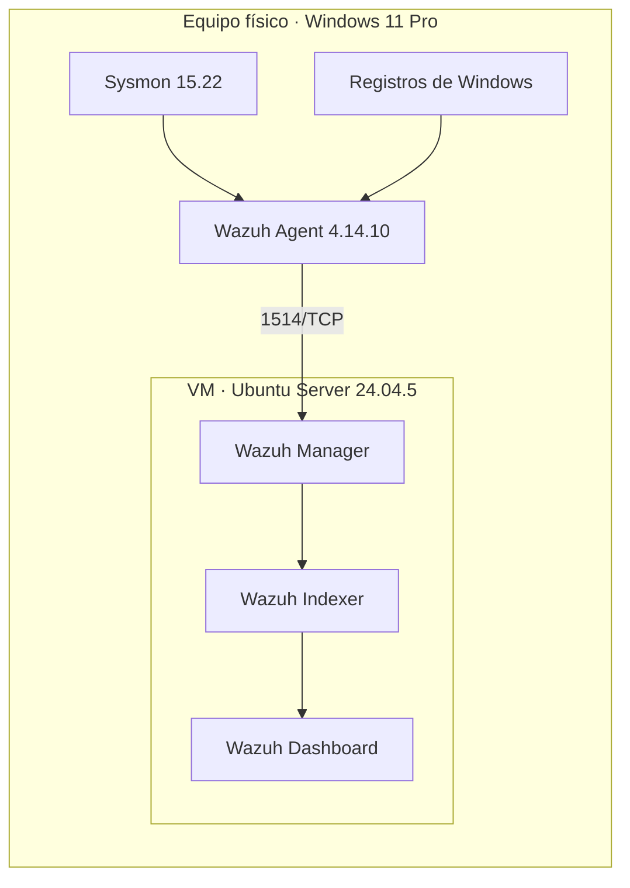

# Home SOC Lab — Wazuh + Sysmon en un endpoint Windows

Laboratorio doméstico de operaciones de seguridad (SOC) construido para practicar las tareas de un analista junior: desplegar un SIEM, incorporar un endpoint, generar actividad controlada, investigar las alertas y **mejorar la detección cuando falla**.

El laboratorio no se limita a instalar herramientas. Cada escenario sigue el mismo método: definir qué se quiere observar, leer las reglas para fijar el resultado esperado, generar la actividad de forma controlada, comparar lo esperado con lo observado y, si hay una brecha, investigar la causa y corregirla.

---

## Resultados principales

| | |
|---|---|
| **26** pruebas de detección en **5** escenarios mapeados a MITRE ATT&CK | [Matriz de pruebas](docs/matriz-pruebas.md) |
| **5** brechas encontradas en el conjunto de reglas por defecto de Wazuh | La actividad quedaba registrada en el endpoint, pero no generaba ninguna alerta útil |
| **7** reglas personalizadas que cierran o reducen esas brechas, validadas con pruebas positivas, benignas y de regresión | [`local_rules.xml`](configs/wazuh/local_rules.xml) |
| **1** caso de ruido investigado hasta su origen: el propio agente de Wazuh | [Caso 0](docs/casos/caso-00-ruido-agente-sca.md) |

**Conclusión:** con la configuración por defecto, Sysmon registraba la actividad de los cinco escenarios, pero en cuatro de ellos Wazuh no generaba una alerta útil. La causa más frecuente eran reglas base de **nivel 0** cuyas reglas hijas solo cubren variantes muy concretas. **Tener visibilidad no equivale a tener detección.**

---

## Arquitectura



| Componente | Versión |
|---|---|
| Wazuh Manager, Indexer y Dashboard (All-in-One) | 4.14.10 |
| Wazuh Agent | 4.14.10 |
| Sysmon | 15.22, configuración [SwiftOnSecurity](https://github.com/SwiftOnSecurity/sysmon-config) v74 |
| Servidor | Ubuntu Server 24.04.5 LTS en VirtualBox (4 vCPU, 8 GB de RAM, 80 GB) |
| Endpoint | Windows 11 Pro |

Detalle completo, incluidos puertos, firewall, flujo de eventos y decisiones técnicas, en [Arquitectura](docs/01-arquitectura.md).

---

## Escenarios y casos

| Caso | Escenario | Técnica ATT&CK | Brecha encontrada | Resultado |
|---|---|---|---|---|
| [0](docs/casos/caso-00-ruido-agente-sca.md) | Alertas no provocadas tras conectar el agente | — | ~66 alertas por ciclo generadas por el módulo SCA del propio agente | Verdaderos positivos benignos; origen confirmado con el árbol de procesos |
| [1](docs/casos/caso-01-autenticacion-fallida.md) | Inicios de sesión fallidos | T1110 | Ninguna en la detección. Reloj del endpoint desfasado 16 s | Detección conforme; desfase diagnosticado y corregido |
| [2](docs/casos/caso-02-powershell-encodedcommand.md) | PowerShell con comando codificado en Base64 | T1059.001, T1027 | `-enc` (la abreviatura más usada) bajaba de nivel 12 a 4 | Regla 100100 |
| [3](docs/casos/caso-03-tarea-programada.md) | Creación de tareas programadas | T1053.005, T1070 | Sin auditoría no había detección; la única alerta era casual y con una descripción incorrecta | Auditoría + reglas 100110 y 100111 |
| [4](docs/casos/caso-04-claves-run.md) | Persistencia en claves Run del registro | T1547.001 | Ninguna alerta (regla base de nivel 0). El FIM tarda hasta 12 h y no ve HKCU | Reglas 100120 y 100121; comparación Sysmon frente a FIM |
| [5](docs/casos/caso-05-conexiones-red.md) | Descargas con PowerShell y BITS | T1071.001, T1105, T1197 | Ninguna alerta. La conexión de BITS la hace `svchost.exe` y no queda registrada | Reglas 100130 y 100131 |

Cada caso documenta el objetivo, el procedimiento, el resultado esperado frente al observado, la investigación, las reglas creadas, las limitaciones y las lecciones aprendidas.

---

## Reglas personalizadas

| ID | Nivel | Detecta |
|---|---|---|
| 100100 | 12 | PowerShell que lanza PowerShell con cualquier abreviatura de `-EncodedCommand` |
| 100110 | 10 | Tarea programada cuya acción es un LOLBin o una ruta escribible por usuarios |
| 100111 | 5 | Tarea programada eliminada |
| 100120 | 7 | Valor escrito en una clave `Run` del registro |
| 100121 | 12 | Valor de una clave `Run` que apunta a un LOLBin o a una ruta escribible por usuarios |
| 100130 | 10 | `bitsadmin.exe` crea un trabajo de transferencia |
| 100131 | 6 | PowerShell se conecta a una IP pública |

---

## Hallazgos destacados

- **Una regla de nivel 0 no es una detección.** Las reglas base de Wazuh para claves Run (92300) y para conexiones de PowerShell (92101) reconocen exactamente la actividad probada, pero no generan alertas si ninguna regla hija coincide.
- **La lógica de una regla puede no coincidir con su descripción.** La 92057 no detecta `-enc`, y la 92004 se activa por un texto en la línea de comandos, no por el proceso que describe.
- **La ejecución delegada esquiva la telemetría centrada en el proceso.** Con BITS, la descarga la realiza `svchost.exe`, no `bitsadmin.exe`, y la conexión no queda registrada con esta configuración de Sysmon.
- **El FIM de Wazuh solo detecta cambios entre dos escaneos consecutivos.** Reiniciar el agente crea una nueva línea base sin generar alertas.
- **La sincronización horaria es un requisito del SIEM.** Un desfase de 16 s en el endpoint provocó dos conclusiones erróneas durante la investigación.
- **La política de auditoría de Windows determina qué se puede detectar.** Sin la auditoría de "Otros eventos de acceso a objetos", la creación de tareas programadas es invisible para las reglas de Seguridad.

---

## Estructura del repositorio

```text
home-soc-lab/
├── README.md
├── configs/
│   └── wazuh/local_rules.xml        ← reglas personalizadas (100100–100131)
├── docs/
│   ├── 01-arquitectura.md           ← componentes, red, flujo de eventos, decisiones
│   ├── ajustes-endpoint.md          ← cambios en el endpoint y cómo revertirlos
│   ├── matriz-pruebas.md            ← las 26 pruebas, brechas y cobertura ATT&CK
│   └── casos/
│       ├── caso-00-ruido-agente-sca.md
│       ├── caso-01-autenticacion-fallida.md
│       ├── caso-02-powershell-encodedcommand.md
│       ├── caso-03-tarea-programada.md
│       ├── caso-04-claves-run.md
│       └── caso-05-conexiones-red.md
└── evidencias/                      ← capturas sanitizadas
```

---

## Cómo reproducirlo

1. **Servidor:** instalar Ubuntu Server 24.04 LTS (o una versión soportada por la [documentación oficial de Wazuh](https://documentation.wazuh.com/current/quickstart.html)) con al menos 4 vCPU, 8 GB de RAM y 50 GB de disco, y desplegar Wazuh All-in-One con el asistente oficial:
   ```bash
   curl -sO https://packages.wazuh.com/4.14/wazuh-install.sh && sudo bash ./wazuh-install.sh -a
   ```
2. **Firewall:** permitir solo 22, 443, 1514 y 1515/TCP desde la red local ([Arquitectura §4.3](docs/01-arquitectura.md#43-firewall-ufw)).
3. **Endpoint:** instalar Sysmon con la configuración de SwiftOnSecurity y el agente de Wazuh, y añadir el canal de Sysmon a `ossec.conf` ([Ajustes del endpoint](docs/ajustes-endpoint.md)).
4. **Sincronización y auditoría:** activar W32Time y la auditoría de "Otros eventos de acceso a objetos" ([Ajustes del endpoint §4 y §5](docs/ajustes-endpoint.md)).
5. **Reglas:** copiar el contenido de [`local_rules.xml`](configs/wazuh/local_rules.xml) en `/var/ossec/etc/rules/local_rules.xml`, validar con `sudo /var/ossec/bin/wazuh-analysisd -t` y reiniciar `wazuh-manager`.
6. **Escenarios:** ejecutar los procedimientos de cada caso y comparar con la [matriz de pruebas](docs/matriz-pruebas.md).

---

## Limitaciones

- Un solo endpoint y un solo nodo de Wazuh, sin alta disponibilidad. El servidor se ejecuta como VM en el mismo equipo que monitoriza.
- El endpoint es un equipo de uso personal, por lo que todas las evidencias se han sanitizado y algunas capturas no se publican.
- Las reglas personalizadas se han validado solo con los casos de prueba documentados. En un entorno real necesitarían una línea base y ajustes por falsos positivos.
- Brechas que siguen abiertas: consultas DNS sin alertas, reconocimiento interno desde PowerShell, borrado de valores Run vía Sysmon y PowerShell sin *Script Block Logging*.
- El ruido que genera el módulo SCA del agente está documentado, pero todavía no se ha ajustado.

Detalle por escenario en cada caso y en la [matriz de pruebas](docs/matriz-pruebas.md#3-brechas-del-conjunto-de-reglas-por-defecto).

---

## Uso responsable

Todas las pruebas se ejecutaron en equipos y redes propios, con comandos benignos y destinos reservados para pruebas (`example.com`). No se utilizó malware real ni se realizaron pruebas contra sistemas de terceros. No se desactivó ningún control de seguridad del endpoint.
