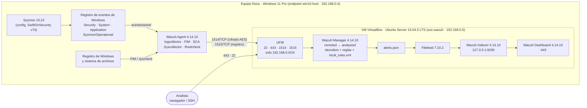

# Arquitectura del laboratorio

Descripción de los componentes, la red, el flujo de eventos y las decisiones técnicas del Home SOC Lab.

---

## 1. Visión general

Un endpoint Windows físico envía telemetría (registros nativos de Windows y eventos de Sysmon) a un servidor Wazuh All-in-One que se ejecuta en una máquina virtual sobre el mismo equipo.



---

## 2. Hardware y virtualización

### 2.1 Equipo físico

| Componente | Especificación |
|---|---|
| Procesador | Intel Core i7-12700F (12 núcleos / 20 hilos) |
| Memoria | 16 GB DDR4 2666 MHz |
| Almacenamiento | SSD de ~1 TB |
| Sistema operativo | Windows 11 Pro, compilación 26300 |
| Hipervisor | Oracle VM VirtualBox |

### 2.2 Máquina virtual

| Recurso | Configuración | Comentario |
|---|---|---|
| Nombre | `ubuntuserver` (hostname `soc-wazuh`) | |
| vCPU | 4 | Mínimo recomendado para All-in-One con 1–25 agentes |
| RAM | 8 GB (7,6 GiB utilizables) | Mínimo recomendado; la mitad de la RAM del equipo físico |
| Disco | 80 GB (`/` en LVM: 77 GB) | Requisito: 50 GB para 90 días de alertas |
| Swap | 4 GiB | |
| Red | Adaptador puente (`enp0s3`) | La VM aparece en la red local como un equipo más |

**Requisitos oficiales de Wazuh 4.14 para All-in-One** (1–25 agentes): 4 vCPU, 8 GiB de RAM y 50 GB de almacenamiento para 90 días. La VM los cumple justos.

### 2.3 Uso de disco observado

| Elemento | Tamaño | Comentario |
|---|---|---|
| Total usado en `/` | 25 GB de 77 GB | Estable entre el 12 y el 17 de noviembre |
| `/var/ossec/queue/vd` | 14 GB | Base de datos de vulnerabilidades (feed CTI). Carga inicial, no crece |
| Índices de alertas (`wazuh-alerts-4.x-*`) | ~6 MB en total | Volumen de alertas muy bajo con un solo agente |
| Caché de `apt` | 1,6 GB | Liberada con `apt clean` |

---

## 3. Componentes y versiones

| Componente | Versión | Ubicación | Función |
|---|---|---|---|
| Wazuh Manager | 4.14.10-1 | VM | Recibe los eventos de los agentes, los decodifica y los evalúa contra las reglas |
| Wazuh Indexer | 4.14.10-1 | VM | Almacena e indexa alertas y datos de estado (basado en OpenSearch) |
| Wazuh Dashboard | 4.14.10-1 | VM | Interfaz web para consultar alertas e investigar |
| Filebeat | 7.10.2-2 | VM | Envía `alerts.json` del Manager al Indexer |
| Wazuh Agent | 4.14.10-1 | Endpoint | Recolecta registros, vigila la integridad (FIM), evalúa la configuración (SCA) e inventaría el sistema |
| Sysmon | 15.22 | Endpoint | Telemetría detallada de procesos, red, archivos, registro y DNS |
| Configuración de Sysmon | SwiftOnSecurity v74 | Endpoint | Define qué eventos se registran |
| Reglas personalizadas | 7 reglas (100100–100131) | VM | [`configs/wazuh/local_rules.xml`](../configs/wazuh/local_rules.xml) |

---

## 4. Red y puertos

### 4.1 Direccionamiento

| Equipo | IP | Interfaz |
|---|---|---|
| Endpoint Windows | `192.168.0.4` | Red local |
| VM Wazuh | `192.168.0.5` | `enp0s3` (puente), DHCP |
| Adaptador Host-Only de VirtualBox | `192.168.56.1` | No interviene en el laboratorio |

### 4.2 Puertos en escucha en la VM

Comprobados con `ss -tlnp`:

| Puerto | Proceso | Escucha en | Accesible desde la red |
|---|---|---|---|
| 22/TCP | `sshd` | Todas las interfaces | ✅ Solo `192.168.0.0/24` (UFW) |
| 443/TCP | Dashboard (`node`) | `0.0.0.0` | ✅ Solo `192.168.0.0/24` (UFW) |
| 1514/TCP | `wazuh-remoted` | `0.0.0.0` | ✅ Solo `192.168.0.0/24` (UFW) |
| 1515/TCP | `wazuh-authd` | `0.0.0.0` | ✅ Solo `192.168.0.0/24` (UFW) |
| 9200/TCP | Indexer (`java`) | **`127.0.0.1`** | ❌ Solo local |
| 55000/TCP | API de Wazuh (`python3`) | `0.0.0.0` / `::` | ❌ Bloqueado por UFW (el Dashboard la consume localmente) |

### 4.3 Firewall (UFW)

```text
Default: deny (incoming), allow (outgoing)

[ 1] 22/tcp     ALLOW IN  192.168.0.0/24   # SSH
[ 2] 443/tcp    ALLOW IN  192.168.0.0/24   # Wazuh dashboard
[ 3] 1514/tcp   ALLOW IN  192.168.0.0/24   # Wazuh agent comms
[ 4] 1515/tcp   ALLOW IN  192.168.0.0/24   # Wazuh agent enrollment
```

Verificación desde el endpoint con `Test-NetConnection`: 22, 443, 1514 y 1515 → `True`; 55000 → `False`.

---

## 5. Flujo de eventos

1. **Generación.** Windows escribe los eventos en sus canales (`Security`, `System`, `Application`). Sysmon escribe los suyos en `Microsoft-Windows-Sysmon/Operational`, según los filtros de su configuración.
2. **Recolección.** El agente lee los canales mediante `eventchannel`. El canal de Sysmon se añadió manualmente a `ossec.conf`. Los módulos FIM, SCA, Syscollector y Rootcheck generan sus propios eventos.
3. **Transporte.** El agente envía los eventos al Manager por **1514/TCP**, cifrados con AES. El registro inicial del agente se hizo por **1515/TCP**.
4. **Análisis.** `wazuh-analysisd` decodifica cada evento y lo compara con el árbol de reglas: primero las reglas de serie (`/var/ossec/ruleset/rules/`) y después las personalizadas (`/var/ossec/etc/rules/local_rules.xml`).
5. **Alerta.** Solo los eventos que coinciden con una regla de **nivel 3 o superior** se escriben en `/var/ossec/logs/alerts/alerts.json`. **Los eventos de nivel 0 se evalúan y se descartan**: no quedan disponibles para buscarlos después.
6. **Indexación.** Filebeat envía las alertas al Indexer, en índices diarios `wazuh-alerts-4.x-AAAA.MM.DD`.
7. **Consulta.** El Dashboard muestra las alertas (*Threat Hunting*). Para el análisis detallado también se consultó `alerts.json` directamente con `jq`.

**Latencia medida:** alrededor de **1 segundo** desde que se produce el evento en el endpoint hasta que se procesa en el Manager ([Caso 1](casos/caso-01-autenticacion-fallida.md)).

> **Consecuencia del paso 5:** gran parte de las brechas encontradas se deben a que la actividad coincidía con reglas base de nivel 0. La telemetría existía en el endpoint y llegaba al Manager, pero no se conservaba como alerta. Ver la [matriz de pruebas](matriz-pruebas.md).

---

## 6. Decisiones técnicas

| Decisión | Alternativas consideradas | Motivo |
|---|---|---|
| **Ubuntu Server 24.04.5 LTS** | Mantener Ubuntu 26.04 con Wazuh 5.0 RC, o forzar Wazuh 4.14 en 26.04 | La documentación oficial de Wazuh 4.14 solo soporta hasta Ubuntu 24.04. Wazuh 5.0 soportaba 26.04 pero era una versión candidata, no estable. Forzar la instalación con `-i` habría dejado una combinación sin soporte |
| **Wazuh 4.14 (estable)** | Wazuh 5.0 RC | Estabilidad, documentación abundante y representatividad de los entornos de producción actuales. Los procedimientos de 4.x y 5.x no son intercambiables (por ejemplo, la 5.x usa el puerto 1517 para los agentes) |
| **All-in-One en una VM** | Despliegue distribuido | Recursos limitados (16 GB de RAM en el equipo físico) y un solo agente. Suficiente para el laboratorio |
| **Reutilizar la VM existente** | Crear una VM nueva | Ya tenía 4 vCPU, 8 GB, 80 GB y red en puente. Se reinstaló el sistema operativo y se conservó la configuración |
| **Disco con LVM ampliado a 78 GB** | Dejar el tamaño por defecto del instalador (39 GB) | El instalador asignó solo la mitad del disco al volumen raíz; se amplió con `lvextend -r` |
| **Red en puente** | NAT, solo anfitrión | El endpoint y el Manager se comunican como dos equipos de la misma red, que es más realista |
| **Configuración de Sysmon de SwiftOnSecurity** | sysmon-modular (Olaf Hartong) | Referencia habitual para empezar, muy comentada y con un volumen de eventos moderado |
| **Nombre de agente genérico (`win10-host`)** | Nombre real del equipo | No exponer el nombre real en capturas y documentación |
| **Reglas personalizadas en `local_rules.xml`** | Modificar las reglas de serie | `local_rules.xml` se conserva en las actualizaciones; los archivos de serie se sobrescriben |

---

## 7. Controles de seguridad aplicados

| Control | Implementación |
|---|---|
| Exposición de red mínima | UFW con denegación por defecto; solo 4 puertos abiertos y solo para la red local. El Indexer escucha en localhost y la API está bloqueada |
| Credenciales | Contraseña de `admin` generada por el instalador y guardada en un gestor de contraseñas. Eliminada del log de instalación (`[REDACTED]`) |
| Archivo de credenciales y certificados | `wazuh-install-files.tar` con permisos `600` (solo root); excluido del repositorio mediante `.gitignore` |
| Acceso administrativo | SSH desde la red local; huella del servidor verificada antes de aceptar la nueva clave tras la reinstalación |
| Integridad del software | Hash SHA256 de la ISO de Ubuntu comprobado; firmas Authenticode de Sysmon (Microsoft) y del agente (Wazuh, Inc) verificadas |
| Sincronización horaria | NTP en la VM (`systemd-timesyncd`) y W32Time en el endpoint, sincronizando cada hora |
| Cambios en las reglas | Copia de seguridad de `local_rules.xml` y validación con `wazuh-analysisd -t` antes de cada reinicio del Manager |
| Puntos de restauración | Instantáneas de VirtualBox: `01-ubuntu-24.04.5-limpio-pre-wazuh` y `02-wazuh-4.14.10-aio-ufw-ok` |

---

## 8. Limitaciones de la arquitectura

1. **Un solo nodo y un solo agente.** Sin alta disponibilidad: si la VM se detiene, se dejan de procesar eventos.
2. **El Manager vive dentro del endpoint monitorizado.** La VM se ejecuta en el mismo equipo físico que vigila. Un compromiso del equipo físico afectaría también al SIEM, y si el equipo se apaga, el SIEM también.
3. **El endpoint es un equipo de uso personal.** La telemetría incluye actividad cotidiana y datos personales (aplicaciones, rutas, SID), lo que obliga a sanitizar todas las evidencias.
4. **IP de la VM por DHCP.** Si cambiara, el agente perdería la conexión con el Manager. La reserva de IP en el router quedó recomendada, pero no se ha documentado su aplicación.
5. **Certificados autofirmados.** El Dashboard usa el certificado generado por el instalador, por lo que el navegador muestra una advertencia.
6. **Recursos en el mínimo recomendado.** 8 GB de RAM y 4 vCPU son suficientes para este volumen, pero dejan poco margen para más agentes o para conservar alertas durante largos periodos.
7. **Sin Script Block Logging de PowerShell (evento 4104).** Las reglas de `0915-win-powershell_rules.xml` no pueden activarse, y no hay visibilidad del código que se ejecuta dentro de PowerShell.
