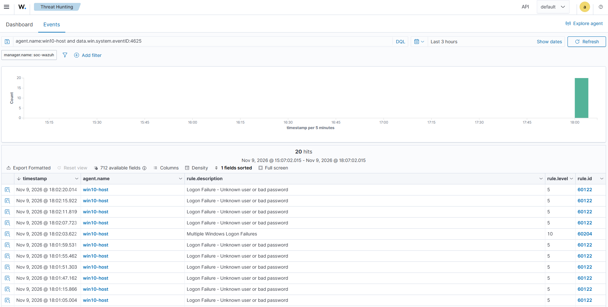

# Caso 1 — Intentos fallidos de autenticación (fuerza bruta simulada)

| Campo | Valor |
|---|---|
| **Fecha** | 2026-11-09 |
| **Endpoint** | `win10-host` (agente `001`) — Windows 11 Pro, compilación 26300 |
| **Fuente de datos** | Registro de Seguridad de Windows (evento 4625) → Wazuh Agent 4.14.10 → Wazuh Manager 4.14.10 |
| **Técnica MITRE ATT&CK** | T1110 — Brute Force (regla 60204) |
| **Tipo de caso** | Escenario planificado de la Fase 4 (escenario 1) |
| **Resultado** | ✅ Detección conforme a lo esperado |
| **Hallazgo colateral** | El reloj del endpoint iba 16,3 s adelantado (servicio W32Time detenido); corregido |

---

## 1. Objetivo

Comprobar que una serie de inicios de sesión fallidos contra el endpoint Windows:

1. queda registrada por Windows (evento 4625);
2. llega a Wazuh y genera una alerta por cada fallo;
3. activa la regla de correlación de fuerza bruta cuando se supera el umbral configurado.

---

## 2. Requisitos previos

**Auditoría de inicios de sesión.** Sin ella, Windows no genera el evento 4625. Como el sistema está en español, la subcategoría se consulta por su GUID o filtrando por su nombre en español:

```powershell
auditpol /get /category:* | Select-String -Pattern "Inicio de sesi"
```

```text
Inicio de sesión                        Aciertos y errores
```

> `auditpol /get /subcategory:"Logon"` falla con el error `0x00000057` en sistemas en español, porque los nombres de subcategoría están traducidos. Una alternativa independiente del idioma es usar el GUID: `{0CCE9215-69AE-11D9-BED3-505054503030}`.

**Recolección.** El agente de Wazuh lee el canal `Security` por defecto, así que no fue necesario cambiar `ossec.conf`. En este escenario la fuente es el registro nativo de Windows, no Sysmon.

---

## 3. Reglas implicadas

Extraídas de `/var/ossec/ruleset/rules/0580-win-security_rules.xml`:

```xml
<rule id="60122" level="5">
  <if_sid>60105</if_sid>
  <field name="win.system.eventID">^529$|^4625$</field>
  <description>Logon Failure - Unknown user or bad password</description>
  <group>authentication_failed,...</group>
  <mitre><id>T1531</id></mitre>
</rule>

<rule id="60204" level="10" frequency="$MS_FREQ" timeframe="240">
  <if_matched_group>authentication_failed</if_matched_group>
  <same_field>win.eventdata.ipAddress</same_field>
  <description>Multiple Windows Logon Failures</description>
  <group>authentication_failures,...</group>
  <mitre><id>T1110</id></mitre>
</rule>
```

La variable `$MS_FREQ` vale **8** (`<var name="MS_FREQ">8</var>`).

**Cómo se interpreta la regla 60204:** genera una alerta de nivel 10 cuando se acumulan **8 eventos de cualquier regla del grupo `authentication_failed`** con la **misma IP de origen** en un plazo de **240 segundos**.

> **Observación:** la regla 60122 está asociada a MITRE T1531 (*Account Access Removal*), una técnica que no describe un inicio de sesión fallido. Parece una asignación poco precisa del conjunto de reglas por defecto. La técnica relevante para este escenario es T1110, la de la regla 60204.

---

## 4. Procedimiento

10 intentos de conexión SMB al propio equipo (`IPC$`), con un usuario inexistente y contraseñas inventadas. No crea cuentas, no modifica el sistema y no puede bloquear ninguna cuenta real.

```powershell
$inicio = Get-Date
1..10 | ForEach-Object {
  net use \\127.0.0.1\IPC$ /user:labtest-noexiste "ClaveFalsa-$_" 2>&1 | Out-Null
  Start-Sleep -Seconds 2
}
$fin = Get-Date
"Inicio: $($inicio.ToString('yyyy-MM-ddTHH:mm:ss'))  Fin: $($fin.ToString('yyyy-MM-ddTHH:mm:ss'))"
"Eventos 4625 en Windows: " + (Get-WinEvent -FilterHashtable @{LogName='Security'; Id=4625; StartTime=$inicio} | Measure-Object).Count
```

> Antes de la ejecución oficial se hicieron dos ejecuciones exploratorias (18:00 – 18:02). Se excluyen del recuento. Antes de la oficial se esperaron más de 240 s para que la ventana de correlación anterior expirase.

---

## 5. Resultado esperado y observado

| Elemento | Esperado | Observado |
|---|---|---|
| Eventos 4625 en Windows | 10 | **10** ✅ |
| Alertas 60122 (nivel 5) | Una por fallo, salvo el que active la correlación | **9** ✅ |
| Alerta 60204 (nivel 10) | Al 8.º fallo desde la misma IP en ≤ 240 s | **Al 8.º fallo** ✅ |
| Total de alertas en Wazuh | 10 | **10** ✅ |

### 5.1 Eventos en Windows

```text
Hora     Usuario          TipoLogon Status     SubStatus  IP   
----     -------          --------- ------     ---------  --
18:02:35 labtest-noexiste 3         0xc000006d 0xc0000064 127.0.0.1
18:02:31 labtest-noexiste 3         0xc000006d 0xc0000064 127.0.0.1                                                             
18:02:27 labtest-noexiste 3         0xc000006d 0xc0000064 127.0.0.1                                                             
18:02:23 labtest-noexiste 3         0xc000006d 0xc0000064 127.0.0.1                                                             
18:02:18 labtest-noexiste 3         0xc000006d 0xc0000064 127.0.0.1                                                             
18:02:14 labtest-noexiste 3         0xc000006d 0xc0000064 127.0.0.1                                                             
18:02:10 labtest-noexiste 3         0xc000006d 0xc0000064 127.0.0.1                                                             
18:02:06 labtest-noexiste 3         0xc000006d 0xc0000064 127.0.0.1                                                             
18:02:02 labtest-noexiste 3         0xc000006d 0xc0000064 127.0.0.1                                                             
18:01:31 labtest-noexiste 3         0xc000006d 0xc0000064 127.0.0.1      
```

| Campo | Valor | Significado |
|---|---|---|
| `LogonType` | 3 | Inicio de sesión por red (SMB) |
| `Status` | `0xc000006d` | Inicio de sesión fallido (código genérico) |
| `SubStatus` | `0xc0000064` | **El usuario no existe** |
| `IpAddress` | `127.0.0.1` | Origen local (prueba por loopback) |

> **Valor para la investigación:** `SubStatus` distingue la **enumeración de usuarios** (`0xc0000064`, el usuario no existe) de un **ataque a una cuenta válida** (`0xc000006a`, contraseña incorrecta). Un SOC trataría el segundo caso con más prioridad.

### 5.2 Alertas en Wazuh (ejecución oficial)

Consulta en el Manager:

```bash
sudo jq -r 'select(.data.win.system.eventID=="4625" and .timestamp >= "2026-11-09T18:19:30" and .timestamp <= "2026-11-09T18:21:30")
  | [.timestamp, .data.win.system.systemTime, .rule.id] | @tsv' /var/ossec/logs/alerts/alerts.json
```

| # | `timestamp` (Manager, UTC−5) | `systemTime` (endpoint, convertido a UTC−5) | Regla |
|---|---|---|---|
| 1 | 18:19:34.246 | 18:19:49.545 | 60122 |
| 2 | 18:19:40.464 | 18:19:55.761 | 60122 |
| 3 | 18:19:44.614 | 18:19:59.897 | 60122 |
| 4 | 18:19:48.692 | 18:20:03.991 | 60122 |
| 5 | 18:19:52.810 | 18:20:08.109 | 60122 |
| 6 | 18:19:56.913 | 18:20:12.196 | 60122 |
| 7 | 18:20:00.989 | 18:20:16.281 | 60122 |
| **8** | **18:20:05.090** | **18:20:20.391** | **60204** |
| 9 | 18:20:09.191 | 18:20:24.490 | 60122 |
| 10 | 18:20:13.300 | 18:20:28.594 | 60122 |

Consulta en el dashboard (*Threat Hunting → Events*):

```text
agent.name:win10-host and data.win.system.eventID:4625
```



---

## 6. Investigación de una discrepancia: desfase de reloj

### 6.1 Síntoma

Al comparar la hora de inicio del bucle en Windows (18:19:49) con las alertas de Wazuh, las 4 primeras alertas aparecían **antes** de que empezara la prueba. Al principio parecía que la regla 60204 se había activado en el 4.º intento.

### 6.2 Hipótesis descartadas

| Hipótesis | Comprobación | Resultado |
|---|---|---|
| A. Faltan alertas por retraso en la ingesta | Volver a consultar con margen de tiempo | ❌ Refutada: la salida no cambió |
| B. Hubo fallos previos que sumaron al contador de 60204 | Buscar alertas `authentication_failed` en los 240 s anteriores | ❌ Refutada: las "alertas previas" eran los 4 primeros intentos de la misma prueba |
| C. Los relojes del endpoint y del Manager no coinciden | Comparar `timestamp` con `systemTime` y medir el desfase con NTP | ✅ **Confirmada** |

### 6.3 Evidencia

La columna `systemTime` de la tabla 5.2 va **unos 15,3 s por delante** de `timestamp` en todas las filas. Medición directa en el endpoint contra un servidor de hora de referencia:

```powershell
w32tm /stripchart /computer:time.windows.com /dataonly /samples:3
```

```text
18:30:42, -16.3244198s
18:30:44, -16.3176890s
18:30:46, -16.3183984s
```

El reloj de Windows iba **16,3 s adelantado**. Causa raíz:

```powershell
w32tm /query /status
```

```text
Error: No se ha iniciado el servicio. (0x80070426)
```

El servicio **W32Time estaba detenido**, con inicio `Manual`. En un equipo que no pertenece a un dominio, ese servicio solo arranca de vez en cuando, y entre sincronizaciones el reloj se desvía.

**Latencia real de ingesta:** si el desfase es de 16,3 s y la diferencia entre `systemTime` y `timestamp` es de 15,3 s, la latencia desde el evento hasta su procesamiento en el Manager es de **alrededor de 1 segundo**.

### 6.4 Corrección aplicada al endpoint

```powershell
Start-Service W32Time
w32tm /resync /force
Set-Service W32Time -StartupType Automatic
```

Verificación posterior:

```text
18:54:12, +00.0002167s
18:54:14, +00.0005624s
18:54:16, +00.0003959s
```

| Ajuste | Antes | Después | Cómo revertirlo |
|---|---|---|---|
| Servicio W32Time | Detenido, inicio `Manual` | En ejecución, inicio `Automatic` | `Set-Service W32Time -StartupType Manual` |
| Desfase con NTP | −16,3 s | +0,0003 s | — |

> **Nota:** `w32tm /resync /force` respondió *"no tenía información hora disponible"* porque se lanzó un instante después de arrancar el servicio. El servicio se sincronizó por su cuenta segundos después, como confirman la hora de la última sincronización correcta en `w32tm /query /status` y la medición de `stripchart`.

---

## 7. Limitaciones de la detección

1. **Depende de que los intentos vengan de la misma IP** (`same_field ipAddress`). Un ataque distribuido entre varias IP, como el *password spraying* desde una botnet, no alcanzaría el umbral en ninguna de ellas.
2. **El umbral es de 8 fallos en 240 s.** Un atacante que haga menos de un intento cada 30 segundos (fuerza bruta lenta) no activaría la regla 60204, aunque cada fallo seguiría generando una alerta 60122 de nivel 5.
3. **Prueba por loopback (`127.0.0.1`).** En un ataque real el campo `ipAddress` mostraría el origen remoto. No se probó desde otro equipo de la red.
4. **Solo se probó el caso de usuario inexistente** (`0xc0000064`). No se probó el de usuario válido con contraseña incorrecta (`0xc000006a`), aunque ambos activan la misma regla 60122.
5. **Una única ejecución oficial.** El resultado es coherente con las ejecuciones exploratorias, pero no se midió la variabilidad.

---

## 8. Lecciones aprendidas

- **La sincronización horaria es un requisito del SIEM.** Un desfase de 16 segundos bastó para llevar a dos conclusiones erróneas. Hay que verificar NTP en **todos** los componentes, no solo en el servidor.
- **`timestamp` y `systemTime` miden cosas distintas.** `timestamp` es la hora de procesamiento en el Manager; `systemTime` es la hora del evento según el reloj del endpoint. Compararlas permite detectar desfases y medir la latencia.
- **Leer la regla antes de interpretar la alerta.** Conocer `frequency`, `timeframe`, `same_field` e `if_matched_group` permite predecir exactamente cuándo salta la correlación y qué ataques quedan fuera de ella.
- **Comprobar las hipótesis con datos.** Las dos primeras hipótesis eran razonables y las dos resultaron falsas; solo la comparación sistemática de las horas reveló la causa real.

---

## 9. Fila para la matriz de pruebas

| ID | Escenario | Técnica | Fuente | Reglas esperadas | Resultado observado | Estado |
|---|---|---|---|---|---|---|
| E1 | 10 inicios de sesión fallidos por SMB (usuario inexistente) | T1110 | Security 4625 | 60122 ×9, 60204 ×1 al 8.º fallo | 60122 ×9, 60204 ×1 al 8.º fallo | ✅ Superado |
