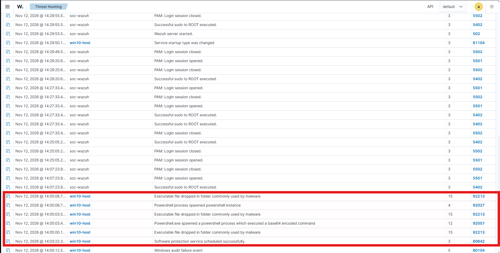
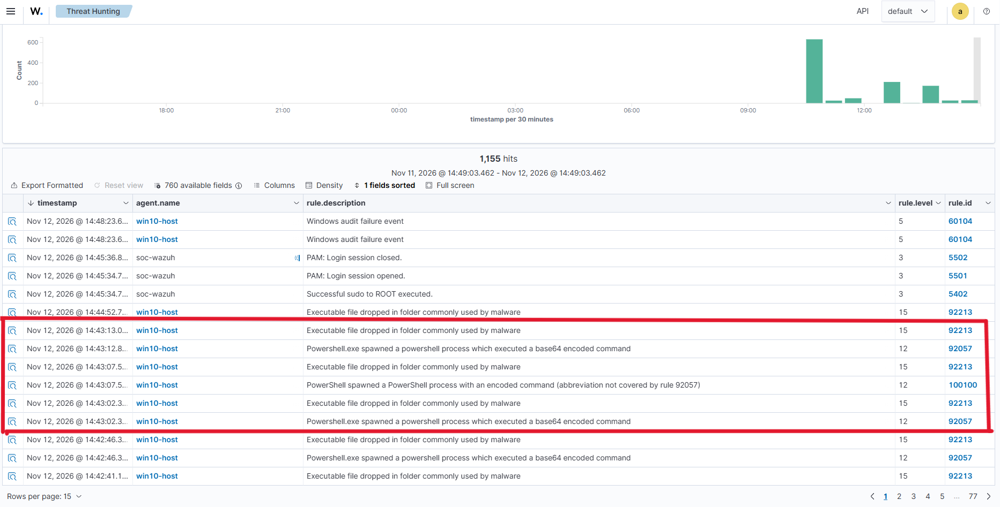

# Caso 2 — PowerShell con comando codificado en Base64: punto ciego y regla personalizada

| Campo | Valor |
|---|---|
| **Fecha** | 2026-11-12 |
| **Endpoint** | `win10-host` (agente `001`) — Windows 11 Pro, compilación 26300 |
| **Fuente de datos** | Sysmon 15.22, evento 1 (creación de procesos) → Wazuh Agent 4.14.10 → Wazuh Manager 4.14.10 |
| **Técnicas MITRE ATT&CK** | T1059.001 — PowerShell · T1027 — Obfuscated Files or Information |
| **Tipo de caso** | Escenario planificado de la Fase 4 (escenario 2) + ingeniería de detección |
| **Resultado** | ⚠️ Punto ciego detectado en la regla 92057 → ✅ corregido con la regla personalizada 100100 |

---

## 1. Objetivo

Comprobar si Wazuh detecta la ejecución de PowerShell con un comando ofuscado en Base64 mediante el parámetro `-EncodedCommand`, una técnica muy habitual en scripts maliciosos y cargadores (*loaders*). PowerShell acepta **cualquier abreviatura** de ese parámetro, así que también se evaluó si la detección cubre las variantes abreviadas que aparecen en ataques reales.

---

## 2. Análisis previo de la regla

Búsqueda de reglas relacionadas en el conjunto de reglas:

```bash
sudo grep -rn -i -E '<description>.*(encoded|base64)' /var/ossec/ruleset/rules/
```

La regla aplicable es la **92057** (`0800-sysmon_id_1.xml`):

```xml
<rule id="92057" level="12">
  <if_group>sysmon_event1</if_group>
  <field name="win.eventdata.parentImage" type="pcre2">(?i)powershell\.exe</field>
  <field name="win.eventdata.commandLine" type="pcre2">(?i)powershell\.exe.+\-\b(encodedcommand|e|ea|ec|encodeda|encode|en|enco)\b</field>
  <description>Powershell.exe spawned a powershell process which executed a base64 encoded command</description>
  <mitre><id>T1059.001</id></mitre>
</rule>
```

**Hipótesis:** la lista de abreviaturas **no incluye `enc`**, que es la forma más usada en ataques reales. Como `\b` exige que la palabra coincida entera, `-enc` no encajaría ni con `e`, ni con `en`, ni con `enco`. Por tanto, **`-enc` no debería activar la regla 92057.**

> Las reglas de `0915-win-powershell_rules.xml` que mencionan Base64 se basan en el registro de PowerShell (*Script Block Logging*, evento 4104), que no está activado en este laboratorio. Sysmon ve **cómo se lanzó** PowerShell, pero no **qué ejecutó por dentro**.

---

## 3. Procedimiento

Se codifica en Base64 un comando inofensivo y se ejecuta desde una sesión de PowerShell con dos variantes del parámetro:

```powershell
$cmd = "Write-Output 'Home SOC Lab - Escenario 2'"
$b64 = [Convert]::ToBase64String([Text.Encoding]::Unicode.GetBytes($cmd))
$inicio = Get-Date
powershell.exe -NoProfile -EncodedCommand $b64     # Variante A
Start-Sleep -Seconds 5
powershell.exe -NoProfile -enc $b64                # Variante B
```

Las dos variantes produjeron la misma salida (`Home SOC Lab - Escenario 2`): son **funcionalmente idénticas**.

Consulta de las alertas en el Manager:

```bash
sudo jq -r 'select(.agent.name=="win10-host" and .timestamp >= "2026-11-12T14:05:02"
  and ((.data.win.eventdata.commandLine // "") | test("NoProfile")))
  | [.timestamp, .rule.id, .rule.level, .rule.description] | @tsv' /var/ossec/logs/alerts/alerts.json
```

---

## 4. Resultado inicial (sin regla personalizada)

Ejecución a las 14:05, **con un usuario sin privilegios de administrador**:

| Variante | Parámetro | Regla activada | Nivel |
|---|---|---|---|
| A | `-EncodedCommand` | 92057 — *…executed a base64 encoded command* | **12** |
| B | `-enc` | 92027 — *Powershell process spawned powershell instance* | **4** |

**Hipótesis confirmada.** La variante más común en ataques reales se degrada de una alerta de **severidad alta (12)** a una **informativa (4)**, que en un SOC con volumen real tiene muchas probabilidades de no investigarse nunca.



---

## 5. Regla personalizada 100100

### 5.1 Decisiones de diseño

| Decisión | Motivo |
|---|---|
| **Colgarla como hija de la regla 92027** (`if_sid`) | Cuando varias reglas hermanas coinciden con un evento, Wazuh solo emite una, y las fuentes consultadas no coinciden sobre cuál gana. Al hacerla hija de la 92027, que **sí** se activa con `-enc`, la regla nueva se evalúa siempre a continuación, sin depender del orden de carga |
| **Incluir todas las abreviaturas válidas**, desde `-e` hasta `-encodedcommand` | Cubrir la variante `-enc` y cualquier otra que no esté en la lista original |
| **Exigir un espacio antes y después del parámetro** | Evitar coincidencias con otros parámetros que empiezan por `e`, como `-ExecutionPolicy` |
| **Aceptar `-` y `/` como prefijo** | PowerShell admite los dos |
| **Nivel 12** | Igualar la severidad de la regla 92057 |
| **ID 100100** | Rango recomendado para reglas personalizadas (100000–120000) |
| **Ubicación: `/var/ossec/etc/rules/local_rules.xml`** | Este archivo se conserva en las actualizaciones de Wazuh; los de `/var/ossec/ruleset/rules/` se sobrescriben |

La regla padre 92027 exige que tanto el proceso (`image`) como su padre (`parentImage`) sean `powershell.exe`:

```xml
<rule id="92027" level="4">
  <if_group>sysmon_event1</if_group>
  <field name="win.eventdata.image" type="pcre2">\\powershell\.exe</field>
  <field name="win.eventdata.parentImage" type="pcre2">(?i)\\powershell\.exe</field>
  <description>Powershell process spawned powershell instance</description>
</rule>
```

### 5.2 Regla

Archivo completo en [`configs/wazuh/local_rules.xml`](../../configs/wazuh/local_rules.xml).

```xml
<!-- Home SOC Lab - Caso 2: cierra el punto ciego de la regla 92057 con la abreviatura -enc -->
<group name="local,sysmon,powershell,">
  <rule id="100100" level="12">
    <if_sid>92027</if_sid>
    <field name="win.eventdata.commandLine" type="pcre2">(?i)\s[-/](e|ec|en|enc|enco|encod|encode|encoded|encodedc|encodedco|encodedcom|encodedcomm|encodedcomma|encodedcomman|encodedcommand)\s</field>
    <description>PowerShell spawned a PowerShell process with an encoded command (abbreviation not covered by rule 92057)</description>
    <mitre>
      <id>T1059.001</id>
      <id>T1027</id>
    </mitre>
  </rule>
</group>
```

### 5.3 Despliegue

```bash
# Copia de seguridad
sudo cp /var/ossec/etc/rules/local_rules.xml /var/ossec/etc/rules/local_rules.xml.bak-$(date +%F)

# (se añade la regla al final de local_rules.xml)
<!-- Home SOC Lab - Caso 2: cierra el punto ciego de la regla 92057 con la abreviatura -enc -->
<group name="local,sysmon,powershell,">
  <rule id="100100" level="12">
    <if_sid>92027</if_sid>
    <field name="win.eventdata.commandLine" type="pcre2">(?i)\s[-/](e|ec|en|enc|enco|encod|encode|encoded|encodedc|encodedco|encodedcom|encodedcomm|encodedcomma|encodedcomman|encodedcommand)\s</field>
    <description>PowerShell spawned a PowerShell process with an encoded command (abbreviation not covered by rule 92057)</description>
    <mitre>
      <id>T1059.001</id>
      <id>T1027</id>
    </mitre>
  </rule>
</group>


# Validar la configuración ANTES de reiniciar
sudo /var/ossec/bin/wazuh-analysisd -t && echo "CONFIGURACION OK"

# Reiniciar solo si la validación es correcta
sudo systemctl restart wazuh-manager
sudo systemctl is-active wazuh-manager
```

---

## 6. Validación y regresión

Ejecución a las 14:43 con tres variantes. La variante A se repite como **prueba de regresión** y la `-ec` sirve para ver qué ocurre cuando tanto la regla de serie como la nueva podrían aplicarse.

| Variante | Antes | Después | Valoración |
|---|---|---|---|
| `-EncodedCommand` | 92057 (12) | 92057 (12) | ✅ Sin regresión |
| `-enc` | 92027 (4) | **100100 (12)** | ✅ **Punto ciego cerrado** |
| `-ec` | — | 92057 (12) | ✅ Gana la regla de serie y no hay alertas duplicadas |

```text
2026-11-12T14:43:02.351-0500  92057   12  Powershell.exe spawned a powershell process which executed a base64 encoded command  -EncodedCommand
2026-11-12T14:43:07.597-0500  100100  12  PowerShell spawned a PowerShell process with an encoded command (abbreviation ...)    -enc
2026-11-12T14:43:12.834-0500  92057   12  Powershell.exe spawned a powershell process which executed a base64 encoded command  -ec
```

> La validación se ejecutó desde una consola de PowerShell **con privilegios de administrador** y la prueba inicial, **sin ellos**. Ninguna de las reglas implicadas comprueba el usuario ni el nivel de integridad del proceso, y el comportamiento fue coherente en los dos contextos.



---

## 7. Investigación: cómo trataría un analista esta alerta

Una alerta de comando codificado no dice **qué** se ejecutó. El primer paso es **decodificar el Base64** que aparece en `data.win.eventdata.commandLine`:

**En el endpoint (PowerShell):**

```powershell
$b64 = "VwByAGkAdABlAC0ATwB1AHQAcAB1AHQAIAAnAEgAbwBtAGUAIABTAE8AQwAgAEwAYQBiACAALQAgAEUAcwBjAGUAbgBhAHIAaQBvACAAMgAnAA=="
[Text.Encoding]::Unicode.GetString([Convert]::FromBase64String($b64))
```

**En el Manager (Linux):**

```bash
echo 'VwByAGkAdABlAC0ATwB1AHQAcAB1AHQAIAAnAEgAbwBtAGUAIABTAE8AQwAgAEwAYQBiACAALQAgAEUAcwBjAGUAbgBhAHIAaQBvACAAMgAnAA==' | base64 -d | iconv -f UTF-16LE -t UTF-8
```

Resultado: `Write-Output 'Home SOC Lab - Escenario 2'`. Es un comando inofensivo, lo que confirma que se trata de la prueba controlada.

> `-EncodedCommand` espera texto en **UTF-16LE**, no en UTF-8. Por eso hace falta `iconv` en Linux. Si se decodifica como UTF-8, aparece un carácter nulo entre cada letra.

**Siguientes preguntas que se haría un analista:** quién es el proceso padre del primer PowerShell (¿una macro de Office, `wscript.exe`, un servicio?), con qué usuario se ejecutó, si hubo conexiones de red justo después (evento 3 de Sysmon) y si se crearon archivos o tareas programadas.

---

## 8. Limitaciones

1. **Solo cubre PowerShell lanzado por PowerShell.** Tanto la 92057 como la 100100 dependen de que el proceso padre sea `powershell.exe`. Un comando codificado lanzado desde `cmd.exe`, `wscript.exe`, `mshta.exe` o una macro de Office **no se ha probado** y podría no estar cubierto por estas reglas.
2. **PowerShell 7 (`pwsh.exe`) no está cubierto.** La regla 92027 solo comprueba `powershell.exe`.
3. **La regla 92027 distingue mayúsculas en el campo `image`** (su patrón no lleva `(?i)`). En la práctica Sysmon registra la ruta en minúsculas, pero una variación de mayúsculas podría evitar la regla padre y, con ella, la 100100.
4. **No se cubren guiones Unicode** (como `–` o `—`), que algunas versiones de PowerShell aceptan como prefijo de parámetro.
5. **Sin Script Block Logging (evento 4104)** no hay visibilidad del código que se ejecuta realmente dentro de PowerShell, solo de la línea de comandos con la que se lanza.
6. **La regla detecta la técnica, no la intención.** Algunas herramientas de administración legítimas usan `-EncodedCommand`. En un entorno real habría que establecer una línea base y documentar las excepciones.

---

## 9. Lecciones aprendidas

- **Leer la lógica de la regla, no solo su descripción.** La descripción de la 92057 sugiere que detecta cualquier comando codificado; su expresión regular demuestra que no es así.
- **Probar variantes, no solo el caso de manual.** Los atacantes usan las formas abreviadas precisamente porque los filtros sencillos buscan la palabra completa.
- **Toda regla nueva necesita una prueba de regresión**, para confirmar que no rompe lo que ya funcionaba ni genera alertas duplicadas.
- **Validar antes de reiniciar.** `wazuh-analysisd -t` evita dejar el Manager parado por un error de sintaxis.
- **Ubicar las personalizaciones donde sobreviven a las actualizaciones**: `local_rules.xml`, nunca los archivos de serie.

---

## 10. Filas para la matriz de pruebas

| ID | Escenario | Técnica | Fuente | Regla esperada | Resultado observado | Estado |
|---|---|---|---|---|---|---|
| E2-A | PowerShell → PowerShell `-EncodedCommand` | T1059.001 | Sysmon 1 | 92057 (12) | 92057 (12) | ✅ Superado |
| E2-B | PowerShell → PowerShell `-enc` (antes de la regla propia) | T1059.001, T1027 | Sysmon 1 | 92057 (12) | 92027 (4) | ❌ Punto ciego |
| E2-B' | PowerShell → PowerShell `-enc` (con la regla 100100) | T1059.001, T1027 | Sysmon 1 | 100100 (12) | 100100 (12) | ✅ Superado |
| E2-C | PowerShell → PowerShell `-ec` (regresión) | T1059.001 | Sysmon 1 | 92057 (12) | 92057 (12) | ✅ Superado |
